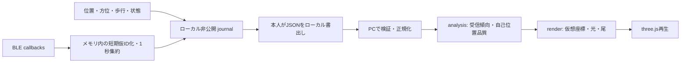

# Signal Echoes — 技術設計

作成・確認日: 2026-11-20 UTC。状態: 未実装の設計。単一iPhoneで検出可能なBLE広告と自己移動を短時間記録し、PCで光点として再生する。光点の位置は送信源の位置ではない。本書の数値は試作パラメータであり、測位精度の保証ではない。今回実行するのは文書作成だけである。

## 1. アーキテクチャと選定

| 層 | 採用案 | 理由・制限 |
| --- | --- | --- |
| 記録 | Swift / SwiftUI、CoreBluetooth、CoreLocation、CoreMotion | iOS権限・ライフサイクルを直接扱う。ネイティブ実機ビルドはMac/Xcodeが必要 |
| 記録中の保存 | アプリ専用領域のNDJSON＋manifest | 追記可能、終了前のクラッシュから完全な行まで回収可能 |
| 転送契約 | `signal-echoes.session` v1の単一JSON | 型検証しやすい。ユーザーがローカル保存・転送を選ぶ |
| 導出・再生 | TypeScript、Vite、three.js、Web Worker | Windows/WSL2で開発、PCブラウザでローカル読込。ReactはMVPには必須でない |
| 検証 | Vitest、Playwright、Swift XCTest | 純粋関数・ブラウザ・実機固有動作を分ける |
| サーバー | なし | クラウドAPI・テレメトリー・外部地図・CDNを使わない |
| ARKit | M2の別モード | カメラに依存するのでポケット運用の解決策にはならない |

依存バージョンは実装開始時の対応表を確認し、exact版＋lockfileで固定する。調査時のVite公式要件はNode 20.19+ / 22.12+。新規実装では保守中のLTSかつ採用Vite対応版を選び、`.node-version` に完全版を記録する。最新という文字列だけで再現性を主張しない。



観測ファイルは不変として扱い、導出・演出はメモリで再計算する。実測の派生ファイルも非公開。計算中に観測値を書き換えない。外部アップロードの経路は作らない。

## 2. BLEで取れるもの・取れないもの

`scanForPeripherals(withServices:nil, options:[CBCentralManagerScanOptionAllowDuplicatesKey:true])` を**前景の短いセッション**で用いる。nilは対応サービスを限定せず、OSが発見したperipheralを返す意味で、周囲の全無線・全Bluetooth機器を見つける保証ではない。Appleはサービス指定を推奨している。S1の既知機器試験ではサービスを指定し、M1のambientモードではnilを用いたことをmanifestに残す。

検出対象は広告していてOSから見えるBLE peripheral。Bluetooth Classic通信の盗聴、Wi-Fi受信、イヤホンの全通信、一般iPhoneの常時発見を前提にしない。接続・GATT読取り・ペアリング・メーカー情報の収集は行わない。`didDiscover` の受信値は広告イベントごとに不定期で、指定Hzで届くAPIではない。

`CBPeer.identifier` はOSが割り当てるUUIDでMACではない。セッション内でも識別子変化や観測欠落があり得る。再起動・端末間・長期間での恒久的同一性を契約にしない。BLEアドレスランダム化とCoreBluetoothのUUID変化が必ず一対一対応する、とも断言しない。1人が複数端末を持つこと、端末が人に属さないこともある。

背景ではサービスUUID指定が必要で、重複検出はまとめられ得る。M1はbackground capabilityを追加せず、非アクティブ化で記録を一時停止する。見知らぬ機器への接続で背景制約を回避しない。

## 3. 記録状態機械と時間

`idle → requestingPermission → ready → recording → paused → recording → finished`。`denied` / `poweredOff` / `unsupported` / `writeFailed` は状態イベント。Bluetoothが使えない場合は合成デモまたは位置のみのセッションに移行し、受信0件と混同しない。

- 開始・停止は本人操作。自動再開はしない。復帰後「再開」で新しい仮ID対応表を使う。
- アプリ非アクティブ化、画面ロック、Bluetooth無効、熱状態critical、保存失敗で停止または一時停止。セッションは開始からの実経過15分で終了し、停止時間もこの枠に含める。
- アプリ死亡後は同じセッションの記録を再開しない。完全なNDJSON行まで回復し、最終確実な時刻以降を不明扱い、`completion: interrupted` とする。
- 保存上限は100,000観測レコードまたは50MiBまたは900,000msの最初。終了状態を書けるよう4KiBと1レコードを予約する。通常レコードは99,999件までで止め、終了イベントを含め100,000件以内とする。journalと最終JSONの両方で50MiB上限を検査し、書出しのメモリ不足・サイズ超過は原記録を保持したままエラーにする。live仮ID表500件上限、超過は新規を無視して件数だけ`overflow`に記録する。静かだったように見せない。

recording中は終了タイマーを使う。OS停止中は期限どおり処理できないため、復帰時に経過15分以上なら再開を禁止し、durationと終了イベントを900,000msに制限して確定する。実際の書出し時刻を観測時刻にしない。

基準時計はセッション開始からの単調増加ms。壁時計は保存期限管理用のprivate manifestだけに置き、標準転送JSONには入れない。BLEはcallback受領時刻、位置は`CLLocation.timestamp`の測定時刻を受領時点の壁時計・単調時計対応から換算し、`ageMs`を保存する。未来1秒超・負時間・受領から5秒超の古い位置は位置用途に使わず状態理由を残す。壁時計補正が1秒超なら`clock_discontinuity`として区間を切る。モーションはセンサーのtimestamp／集計期間を同じ単調時計へ変換する。セッションを跨いだ時計整列はしない。

### センサーの頻度と品質

| 情報 | 要求／保存 | 利用・失敗時 |
| --- | --- | --- |
| BLE | callback随時、仮IDごとに1秒ビンの中央値・件数・最終受領時刻 | 無受信のビンは作らない。RSSI=0の架空観測を挿入しない |
| 位置 | `desiredAccuracy=kCLLocationAccuracyBest`, `distanceFilter=1m`を開始値。更新頻度保証なし | 最新の新規測定を最大1Hz保存。重複timestampを再測定扱いしない |
| 方位 | `headingFilter=5°`、最大1Hz保存 | 負のheadingAccuracyは無効。30°超なら表示の向きに使わない |
| CoreMotion | `deviceMotionUpdateInterval=0.1s`を試す、保存は1Hzの要約 | 生の加速度を二重積分して位置にしない。対応・権限を確認 |
| 歩数 | CMPedometerの非同期更新、1Hz以下で区間増分保存 | 利用不可はnull。コールバックが遅れても0歩で補わない |
| 状態 | 変化時＋recording中1秒heartbeat | heartbeatはスキャン状態であり受信保証ではない |

Core LocationはGPS専用値ではなくOSの位置推定。`horizontalAccuracy<0`は無効。0〜20mをusable、20m超50m以下をcoarse、50m超／reducedAccuracy／古すぎる値はunavailableとする（アプリ側暫定基準）。usableも真値を保証しない。低精度円は95%信頼区間と呼ばない。

位置が使えない屋内では固定ステージと時系列で楽しむ。経路を無理に直進補間しない。歩数は移動の有無の補助で、進行方向・速度ベクトルを復元できない。転送の`headingDeg`は有効なtrueHeadingだけを0以上360未満で保存し、負値や品質不良ならnullとする。磁北値を黙って真北へ読み替えない。スマホの向きは頭や進行方向とも異なる。階段・エレベーター・ホーム階はM1では`floor:null`、描画床は常に演出の高さ0。階数や気圧変化から駅の実階層を自動確定しない。

## 4. 短期仮識別とデータ保護

対応表は `CBPeer UUID → {randomToken, bornMs, lastSeenMs}` のメモリのみ。失効判定は全lookupで行い、recording中の1秒タイマーでも失効項目を除去する。callbackが来ないまま古い対応を保持し続けない。tokenはランダム128bit相当のhexを`e-`に続ける。OS UUIDのハッシュを使わない。hashのソルトを変える設計より、そもそも元IDを出力しない設計を選ぶ。

寿命はbornから120秒、途絶はlastSeenから30秒。境界は`>=`で切る。終了・一時停止・Bluetooth状態変化でも表を全破棄。次の観測では新しいtokenを発行し、旧tokenへのリンクや再識別特徴量を保存しない。表示には8秒後に消える粒が30秒以内に再出現することはあるが、連続して観測したように線を引かない。OS側で別UUIDに見えたものは別トレースとし、広告内容やRSSIで結合しない。

```text
onDiscover(peer, rssi, receivedMs):
  if state != recording or central.state != poweredOn: return
  expireEntries(now=receivedMs)  // born>=120s または silence>=30s
  if rssi is not finite or rssi < -127 or rssi > 20:
      increment invalidRssiCount; return
  // 127などはこのアプリの防御的レンジ検査で除く。
  // CoreBluetooth didDiscoverの127の意味を公式で確認済みとはしない。
  key = peer.identifier          // ここから外へ渡さない
  if key not in map:
      if map.size >= 500: increment overflowCount; return
      map[key] = newRandomToken(receivedMs)
  map[key].lastSeenMs = receivedMs
  // 区間 [k*1000,(k+1)*1000)、tMs=(k+1)*1000
  bucket(map[key].token, floor(receivedMs/1000)).append(rssi, receivedMs)
  // peer.name, advertisementData, key をloggerに渡さない

flushClosedBucket(token, values, tMs):
  emit ble(token, tMs, median(values.rssi), count(values), max(values.time))
```

保存先はiOS Application Supportの専用ディレクトリ。Data Protectionのcompleteを設定し、バックアップ除外を付けて読戻し検証する。ロック前のflush失敗は中断として回復する。期限は作成から24時間、稼働中は1分おき、起動時にも削除。時計逆行時は保持を延ばさず期限管理エラーとして削除対象にする。削除はアプリが保持するコピーのunlinkであり、OSバックアップ・本人が作った別コピーの完全消去保証ではない。

private manifestは保持期限と収集条件、無効・drop件数、callback間隔の診断集計を持つ。D02向けcallback間隔は仮IDごとにメモリで差分を計算して全体ヒストグラム（10ms刻み、上限60秒＋overflow）に加算し、p50/p95はこの分解能の概数、最大gapは別集計とする。生callback列やUUIDは診断にも保存しない。診断集計は標準export外で、同じ24時間保持を適用する。

標準exportには仮ID化した集約RSSIと自己ローカル座標だけを出す。rawという語は「未導出の観測ファイル」を意味し、無線パケットdumpではない。実機の座標・仮IDログはどの形式でもprivate。初期版はexportの共有シート任せにせず、保存先を本人が選ぶこととクラウド保存先を避けることを説明する。Mac経由のFinderファイル転送または本人管理のローカル転送の成立をS1で確認する。

## 5. 座標と自己軌跡

標準exportは右手系のローカル座標: x=東、y=上、z=南、単位m。最初のusable位置を原点とする。短い区間で次の近似を用い、原点から2km超は新しい`segmentId`で再原点化する。地理原点はメモリのみで、緯度経度をファイルへ保存しない。端末OSモデル名・シリアル・Apple IDも標準exportから除く。

```text
R = 6378137
x = R * cos(lat0) * wrapRadians(lon - lon0)
z = -R * (lat - lat0)       // 緯度経度はrad
coordinate = [x, 0, z]      // y=0は平面化。実高度が0という意味ではない
```

測定間で、経過時間dt秒に対して水平変位が `max(15*dt, hAccA+hAccB+5)` mを超えた場合はjumpとして区間切断し、線を結ばない。これは徒歩用の外れ値検査で、走行列車の軌跡は対象外。電車移動を見つけたと推論しない。

描画上の自己軌跡の補間は同一segment内のusable観測2点、間隔5秒以下のみ。補間された自己位置は`interpolated_self`と表示し、観測に戻さない。coarseは個別の誤差円と破線候補だけ、unavailableや長いgapは分断。見やすさの平滑化はrender側だけに適用する。自己位置の品質とBLE観測充足度を掛け合わせて「人物位置の信頼度」を作らない。

## 6. 保存スキーマ v1

### 標準転送JSON

```text
SessionV1 = {
  schema: "signal-echoes.session", version: 1,
  provenance: "synthetic" | "measured",
  sessionId: string, durationMs: integer [0,900000],
  coordinateFrame: "local-east-up-south-m", seed: uint32,
  capture: { mode: "synthetic" | "foreground",
             serviceFilter: "none" | "configured",
             binMs: 1000, completion: "complete" | "interrupted" },
  observations: { ble: BleBin[], self: SelfSample[], status: StatusEvent[] }
}
BleBin = {tMs:int, traceId:string, rssiMedianDbm:number [-127,20],
          sampleCount:int [1,1000000], lastSeenMs:int}
SelfSample = {tMs:int, segmentId:string, source:"synthetic"|"coreLocation",
              positionM:[number,number,number]|null, horizontalAccuracyM:number|null,
              ageMs:int, quality:"usable"|"coarse"|"unavailable",
              headingDeg:number|null, headingAccuracyDeg:number|null,
              stepsDelta:int|null, stepsIntervalMs:int|null, floor:null}
StatusEvent = {tMs:int, state:"recording"|"paused"|"finished"|"interrupted"|"degraded",
               reason:enum, scanActive:boolean, droppedCount:int}
```

`reason`は`user_start/user_stop/heartbeat/app_inactive/bluetooth_off/permission_denied/location_unavailable/clock_discontinuity/overflow/storage_limit/write_failed/recovered_interruption/resumed/thermal`。詳細文字列に端末情報を紛れ込ませない。

制約: 全時刻はセッション内。`BleBin.tMs`は1000の倍数で、`tMs-1000 <= lastSeenMs < tMs`。同じtraceId・tMsは一件。各配列は時刻順、同時刻はtraceIdまたは元の入力順で安定化。欠測は配列の空白とstatusで表す。selfがnullならqualityはunavailable。使えない位置を[0,0,0]で偽装しない。全数値有限、追加プロパティ不可、traceIdは1〜64文字、sessionIdは1〜64文字、位置の各成分絶対値10,000以下。durationMs以内の閉じたビンを保存し、最終端数ビンはM1では捨てる（最大1秒の末尾欠落を終了要約に示す）。

100,000件はble+self+statusの合計。最大50MiBを読込前に検査し、ZIPは非対応、JSON深さ10・文字列長上限・配列件数・有限値を検証する。未知versionは拒否し、黙って旧形式として読むことはしない。順序の乱れはworkerで安定ソートできるが、その件数をインポート結果に出す。重複・矛盾・不足必須値はエラー。schema上でsyntheticを名乗れること自体は公開安全性の証明にはならない。

### 合成JSON入力例（完全な最小セッション）

以下は架空の原点・架空のIDのみ。1秒ビンの受信強度が10秒で9dB上昇する例。自己位置は2点だけなので中間9秒を経路として補間しない。

```json
{
  "schema": "signal-echoes.session",
  "version": 1,
  "provenance": "synthetic",
  "sessionId": "demo-rise-001",
  "durationMs": 10000,
  "coordinateFrame": "local-east-up-south-m",
  "seed": 42,
  "capture": {"mode": "synthetic", "serviceFilter": "none", "binMs": 1000, "completion": "complete"},
  "observations": {
    "ble": [
      {"tMs":1000,"traceId":"demo-a","rssiMedianDbm":-80,"sampleCount":3,"lastSeenMs":900},
      {"tMs":2000,"traceId":"demo-a","rssiMedianDbm":-79,"sampleCount":3,"lastSeenMs":1900},
      {"tMs":3000,"traceId":"demo-a","rssiMedianDbm":-78,"sampleCount":3,"lastSeenMs":2900},
      {"tMs":4000,"traceId":"demo-a","rssiMedianDbm":-77,"sampleCount":3,"lastSeenMs":3900},
      {"tMs":5000,"traceId":"demo-a","rssiMedianDbm":-76,"sampleCount":3,"lastSeenMs":4900},
      {"tMs":6000,"traceId":"demo-a","rssiMedianDbm":-75,"sampleCount":3,"lastSeenMs":5900},
      {"tMs":7000,"traceId":"demo-a","rssiMedianDbm":-74,"sampleCount":3,"lastSeenMs":6900},
      {"tMs":8000,"traceId":"demo-a","rssiMedianDbm":-73,"sampleCount":3,"lastSeenMs":7900},
      {"tMs":9000,"traceId":"demo-a","rssiMedianDbm":-72,"sampleCount":3,"lastSeenMs":8900},
      {"tMs":10000,"traceId":"demo-a","rssiMedianDbm":-71,"sampleCount":3,"lastSeenMs":9900}
    ],
    "self": [
      {"tMs":1000,"segmentId":"s0","source":"synthetic","positionM":[0,0,0],"horizontalAccuracyM":5,"ageMs":0,"quality":"usable","headingDeg":90,"headingAccuracyDeg":10,"stepsDelta":1,"stepsIntervalMs":1000,"floor":null},
      {"tMs":10000,"segmentId":"s0","source":"synthetic","positionM":[9,0,0],"horizontalAccuracyM":5,"ageMs":0,"quality":"usable","headingDeg":90,"headingAccuracyDeg":10,"stepsDelta":9,"stepsIntervalMs":9000,"floor":null}
    ],
    "status": [
      {"tMs":0,"state":"recording","reason":"user_start","scanActive":true,"droppedCount":0},
      {"tMs":10000,"state":"finished","reason":"user_stop","scanActive":false,"droppedCount":0}
    ]
  }
}
```

heartbeatは実記録では毎秒出すが、この合成最小例は開始終了だけである。受信充足度の例はBLE配列から計算し、実機の稼働率はheartbeatのある別fixtureで試験する。

## 7. 推定アルゴリズムと演出の分離

MVPが分類するのは**受信強度傾向**だけ。同行・接近・すれ違い分類器は実装しない。自己歩行中に安定受信が続いても、同行する機器、固定機器、送信電力変化などを区別できないため、「自己移動中の受信継続」という併記までに留める。

設定正本は将来の`packages/core/src/config.ts`。以下は`analysisVersion: heuristic-v1`、`renderVersion: orbs-v1`の契約である。

| パラメータ | v1 | 意味 |
| --- | --- | --- |
| binMs | 1000 | 受信中央値の時間幅 |
| smoothingMs | 5000 | 表示強度用の後方中央値窓 |
| trendWindowMs | 10000 | 傾向用の後方窓 |
| minimumBins / minimumSpanMs | 8 / 7000 | 傾向を出す最低条件 |
| maxMissingRunMs | 2000 | 窓内の連続欠測がこれを超えるとunknown |
| trendSlopeThreshold | 0.5 dB/s | 上昇／下降の暫定境界 |
| minimumNetChange | 5 dB | 傾向に必要な最初と最後の中央値差 |
| maxResidualMAD | 6 dB | 雑音が多すぎる窓を除く基準 |
| freshMs / invisibleMs | 3000 / 8000 | 受信後の鮮明表示期限／残光消失 |
| traceLifetimeMs / traceSilenceMs | 120000 / 30000 | 仮IDの寿命／対応切断 |
| sceneLimit | 256 | 描画する粒上限。人数推定ではない |

後方窓は`(t-window,t]`、未来観測は使わない。傾向は生の1秒中央値にTheil–Sen slope（全ペア傾きの中央値）を適用する。最多10点なので全ペア計算でよい。残差MADは直線の切片を`median(y-slope*x)`として求める。中央値は偶数個なら中央2つの平均。RSSI外れ値は都合よく削除せず、品質判定に反映する。

```text
analyzeTrace(bins, t):
  recent = bins with t-10000 < bin.tMs <= t
  latest = last bin with bin.tMs <= t
  if no latest: return absent
  age = t - latest.lastSeenMs
  smoothSet = bins with t-5000 < bin.tMs <= t
  smooth = median(smoothSet.rssi) if nonempty else null
  trend = unknown
  quality = insufficient
  // maxMissingRunは10個の想定1秒枠。前後端の空白も数える。
  if recent.count >= 8 and span(recent) >= 7000
     and maxMissingRun(recent,t) <= 2000 and age <= 3000:
       slope = median((yj-yi)/((tj-ti)/1000) for all i<j)
       intercept = median(yi-slope*(ti/1000))
       residualMAD = median(abs((yi-slope*(ti/1000)-intercept)
                              - medianResidual))
       net = recent.last.rssi - recent.first.rssi
       quality = sufficient if recent.count==10 and residualMAD<=6 else moderate
       if residualMAD > 6:
           quality=insufficient
       else if slope >= 0.5 and net >= 5: trend=rising
       else if slope <= -0.5 and net <= -5: trend=falling
       else if abs(slope) < 0.5 and abs(net) < 5: trend=stable
       else: trend=variable
  return {smoothRssiDbm:smooth, trend, quality, validBins:recent.count,
          slopeDbPerSec:computedOrNull, residualMADDb:computedOrNull,
          ageMs:age, sourceDirection:null, sourceDistanceM:null,
          physicalMotion:unknown}

renderTrace(analysis, selfAtT, sessionId, traceId, seed, t):
  if analysis.ageMs >= 8000: return no particle
  alpha = 1 if age<=3000 else (8000-age)/5000
  // 不受信時の残光だけは最後の有効なsmoothを保持する。観測にしない。
  intensity = clamp((lastKnownSmoothRssi + 95)/40, 0.15, 1)
  h = FNV1a32(UTF8(sessionId + '|' + traceId + '|' + decimal(seed)))
  theta = 2*pi*(h+0.5)/2^32
  anchor = selfAtT.usablePosition or fixedStageOrigin
  virtualPosition = anchor + [6*cos(theta), 1.2, 6*sin(theta)]
  return {virtualPosition, intensity, opacity:alpha,
          layout:'seeded-ring', positionBasis:'artistic',
          directionObserved:false, distanceObserved:false,
          anchorBasis:selfAtT.basis, stale:age>3000}
```

FNV1a32はoffset 2166136261、各byteにxor後16777619を乗じunsigned32へ丸める。暗号・匿名化には使わず、架空の配置の再現にだけ使う。入力のtraceIdは既に短期の仮ID。固定半径6は「実機から6m」という意味ではなく、床スケール上の演出値。仮想送信源への距離ツールチップは付けない。

自己位置が欠測のときの固定ステージは別の背景と「位置なし」バッジを使い、実経路との位置連続性を示さない。表示アンカーを切り替えるときはトレースの尾を切る。自己位置に有効な前後2点がない時刻は、5秒以下の区間補間条件を満たさない限り固定ステージへ切り替える。

常に同じ受信強度でも他者の位置は一意に決まらない。`quality=sufficient`の意味は窓内観測が充足しただけで、物理位置の確度ではない。数値の確率・メートル推定・他者速度を出さない。RSSI→距離のpath-loss式は送信電力・伝搬指数・遮蔽が未知なのでv1には入れない。

### 上の入力をt=10000msで処理した出力例

schemaは派生結果で、観測ファイルとは別。表示座標は小数4桁へ丸めた例である。最終受信は9900msなのでageは100ms、5秒中央値は-73dBm。slopeは1dB/sだが接近の真偽は不明。

```json
{
  "schema":"signal-echoes.derived",
  "version":1,
  "sessionId":"demo-rise-001",
  "provenance":"synthetic",
  "analysisVersion":"heuristic-v1",
  "renderVersion":"orbs-v1",
  "tMs":10000,
  "traceId":"demo-a",
  "analysis":{
    "smoothRssiDbm":-73,
    "trend":"rising",
    "quality":"sufficient",
    "validBins":10,
    "slopeDbPerSec":1,
    "residualMADDb":0,
    "ageMs":100,
    "sourceDirection":null,
    "sourceDistanceM":null,
    "physicalMotion":"unknown"
  },
  "render":{
    "virtualPosition":[14.5956,1.2,-2.1654],
    "intensity":0.55,
    "opacity":1,
    "layout":"seeded-ring",
    "positionBasis":"artistic",
    "anchorBasis":"observed_self",
    "directionObserved":false,
    "distanceObserved":false,
    "stale":false,
    "tailSeconds":0
  }
}
```

尾は過去最大3秒のrenderサンプルを使う演出で、自己位置・受信が途切れた境界を跨がない。上の例は自己位置の9秒gap直後なので尾0。強度変化が上昇→下降の山でも「通過した人物」とは出さない。任意のすれ違い演出は後日のopt-inプリセットに留め、MVPの推定結果へ混ぜない。

## 8. 失敗ケースと退避

| ケース | 誤った解釈 | v1の対応 |
| --- | --- | --- |
| 身体・バッグで遮蔽 | 相手が離れた | 受信低下とだけ記録、物理的運動unknown |
| 反射・送信出力変更 | 距離が急変 | 揺れ・MADを表示、位置を逆算しない |
| 広告周期が長い | 周囲に誰もいない | insufficient。検出0件と不在を分ける |
| UUIDが変わる | 新しい人物が到着 | 新しい短期トレース。人物ラベルなし |
| 同じUUIDが長く見える | 一日同行 | 120秒で強制分割、リンクなし |
| 受信が終わる | 人が去った | 3〜8秒残光、以降消す。消失理由不明 |
| 画面ロック・背景 | 電波のない空間 | paused帯。復帰時は手動再開 |
| OS位置が駅で跳ぶ | 改札間を瞬間移動 | segment切断、低精度・不明表示 |
| 方位が乱れる | 人の視線が変化 | 経路接線・固定向きへ退避。端末方位を視線と呼ばない |
| 階が違う | 同じ床面に人がいる | floor unknown、床は抽象表現 |
| 256粒超 | 人数を過少表示 | 安定hash順で256件を選び「表示上限」を表示、全観測は規定上限内で保持 |
| インポート破損・未知version | 勝手な修復 | 理由付きで拒否。既存再生状態を壊さない |

## 9. 実装境界とセキュリティ

純粋関数`validateSession → normalizeTime → analyzeSignal → buildRenderFrame`を分ける。UIは観測を受け取り、送信源の座標を直接作らない。TypeScriptで`ObservedSelfPosition`と`ArtisticParticlePosition`を別型にし、粒には後者しか渡さない。型だけに頼らずruntime schemaでも派生値の混入を拒否する。

ブラウザはFile APIで読み、IndexedDB/localStorageへ実測を保存しない。session切替時にWorkerとGPU resourcesを解放する。セル内やファイル名を`innerHTML`に挿入しない。依存とフォントはローカルbundle。配布版を将来作る場合のCSPは原則`default-src 'self'; connect-src 'none'; img-src 'self' blob:; worker-src 'self' blob:`を起点に必要資源を限定する（Vite devのHMRは開発時だけ別設定）。ネットワーク試験で確認し、CSPだけで非送信を断言しない。

公開データはgeneratorと固定seedから再生成する。実測ファイルの`provenance`を書き換えたもの、原点移動した実経路、丸めた実測を合成データとして公開しない。機密検査は`.gitignore`に加えallowlistとgenerator再生成一致を用いる。

## 10. ARKit／端末条件

M1の暫定deployment targetはiOS 17以降。実機OSとXcodeの対応を開始時に確認し、実測機種を適合表に残す。これはiOS 17を要求するAPIがあるという主張ではなく、試験範囲を絞る製品判断。Bluetooth・位置・歩数は各可用性と権限を調べ、未対応でもクラッシュしない。

ARKitのM2案は`ARWorldTrackingConfiguration.isSupported`を確認し、カメラ許可を別途取得する。映像やARWorldMapは保存せずposeだけを最大10Hzで保存する別schema拡張が必要。暗所・遮蔽・人が多い動的場面・中断で追跡品質が落ちる。`limited/notAvailable`区間で位置を確定せず、再初期化は別segment。AR座標とGPS座標を根拠なく同じ原点へ結合しない。人混みで撮影する運用を本計画の前提にしない。

## 11. 一次資料（確認日2026-11-20）

- [Apple: scanForPeripherals](https://developer.apple.com/documentation/corebluetooth/cbcentralmanager/scanforperipherals%28withservices%3Aoptions%3A%29) — nil・サービス指定・背景スキャン条件。
- [Apple: didDiscover](https://developer.apple.com/documentation/corebluetooth/cbcentralmanagerdelegate/centralmanager(_:diddiscover:advertisementdata:rssi:).md) — callbackとRSSI。
- [Apple: CBPeer.identifier](https://developer.apple.com/documentation/corebluetooth/cbpeer/identifier) — OSのUUID。
- [Apple: 背景処理](https://developer.apple.com/library/archive/documentation/NetworkingInternetWeb/Conceptual/CoreBluetooth_concepts/CoreBluetoothBackgroundProcessingForIOSApps/PerformingTasksWhileYourAppIsInTheBackground.html) — 重複集約、停止可能性。
- [Bluetooth SIG: LE Privacy](https://www.bluetooth.com/blog/bluetooth-technology-protecting-your-privacy/) — ランダムアドレス。CoreBluetooth UUIDの寿命を規定する資料ではない。
- [Bluetooth SIG: Direction Finding](https://www.bluetooth.com/learn-about-bluetooth/feature-enhancements/direction-finding/) — AoA/AoDは特殊な信号とアンテナ構成を使う。通常のRSSIスキャンへの機能追加とは扱わない。
- [Apple: horizontalAccuracy](https://developer.apple.com/documentation/corelocation/cllocation/horizontalaccuracy)、[headingAccuracy](https://developer.apple.com/documentation/corelocation/clheading/headingaccuracy.md)、[accuracyAuthorization](https://developer.apple.com/documentation/corelocation/cllocationmanager/accuracyauthorization.md) — 無効値・精度制限。
- [Apple: CMPedometer](https://developer.apple.com/documentation/coremotion/cmpedometer.md)、[CMPedometerData](https://developer.apple.com/documentation/coremotion/cmpedometerdata) — 利用可否、許可、推定歩行情報。
- [Apple: AR追跡品質](https://developer.apple.com/documentation/arkit/managing-session-life-cycle-and-tracking-quality)、[座標系](https://developer.apple.com/documentation/arkit/understanding-world-tracking) — カメラと動き、品質状態。
- [Apple: バックアップ除外](https://developer.apple.com/documentation/foundation/urlresourcevalues/isexcludedfrombackup.md) — Application Supportへの設計根拠。転送済み文書の保持を制御するものではない。
- [Vite: Getting Started](https://vite.dev/guide/)、[three.js: Installation](https://threejs.org/manual/pages/installation.html) — Web側の開発経路。

実機到達率・閾値妥当性・位置誤差・電池消費・実際の面白さは未検証。手順は [03](03-implementation-roadmap.md)、受入は [04](04-test-and-acceptance.md)、環境判断は [05](05-open-questions.md)、確認証拠は [06](06-handoff-audit.md)。